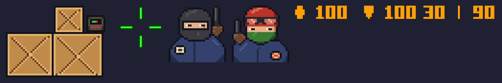

# Counter-Strike 1.6 theme for T3 Code

A pixel-art fan theme for [T3 Code](https://t3.codes): old olive menu panels (VGUI) in the sidebar, a dark console-style backdrop with scanlines in the chat area, a T and a CT on either side, amber HUD numbers, and a green crosshair cursor. Dark mode only.



## Install

The ready-to-use theme is [`dist/theme.json`](dist/theme.json). T3 Code applies themes through its agent tools, so in any T3 Code thread ask:

> Apply the theme in `dist/theme.json` from this repo with `t3_theme_set`, theme id `cs16`.

To undo, switch back to a built-in theme (`t3-chat`, `grove`, `ocean`, `ember`, `iris`).

The characters show only when the window is at least 1500px wide, and the HUD at 1100px and wider, so they don't sit behind messages.

## Editing

| What | Where |
| --- | --- |
| Pixel art (one character per pixel) | `sprites/*.txt` |
| Colors for each sprite letter | `sprites/palette.json` |
| HUD text and pixel font | `HUD` / `FONT` in `build.py` |
| CSS (`@name@` = sprite `name` as base64) | `src/theme.css` |
| App color roles | `src/theme.base.json` |

Rebuild after any change (needs Python 3 and Pillow):

```sh
python3 build.py
```

This writes `dist/theme.json` and `dist/sheet.png`. T3 Code caps theme CSS at 20,000 characters; the build fails if you go over.

---

Fan-made and not affiliated with Valve. Counter-Strike is a trademark of Valve Corporation. All sprites are original pixel art.
